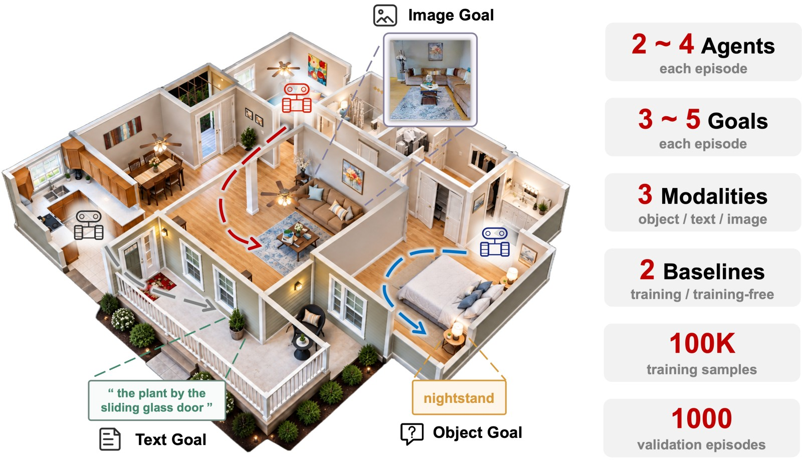

# HM3D-M³: A benchmark for multi-agent, multi-modal, multi-object goal navigation

[Project page](https://robo-lavira.github.io/hm3d-m3/) · [Code](https://github.com/NJU-R-L-Group-Embodied-Lab/hm3d-m3-code) · [Episodes (GitHub Releases)](https://github.com/NJU-R-L-Group-Embodied-Lab/hm3d-m3-code/releases/tag/v1.0.0) · [Training data (Hugging Face)](https://huggingface.co/datasets/NJU-R-L-Group-Embodied-Lab/HM3D-M3)



> **One-line instruction for a coding agent to reproduce our work:** set up the HM3D-M³ environment, download the data and reproduce the LaViRA-M³ results by following <https://github.com/NJU-R-L-Group-Embodied-Lab/hm3d-m3-code/blob/main/sim-code/AGENT_SETUP.md>.

A team of **K agents** starts at distributed locations in a photorealistic HM3D
scene and searches for an unordered set of **M object goals**. Each goal is given
in one of **three modalities**:

| Modality | Goal specification |
| --- | --- |
| **ON** | open-vocabulary object category name |
| **TN** | text description of one object instance |
| **IIN** | reference image of one object instance |

A goal counts for the team regardless of which agent found it. The episode ends
when all M goals are found or every agent has used its budget. We report
goal-level **SR**, makespan-normalized **SPL**, and per-modality found rates
**ON / TN / IIN**. SR is the mean fraction of goals found per episode; SPL scales it by
*d\*_team* / max(*d\*_team*, *T*), where *d\*_team* is the oracle team makespan and *T* the
team's makespan; ON / TN / IIN are found rates over the goals of each modality
([`sim-code/benchmark/metrics.py`](sim-code/benchmark/metrics.py)).

## Data

| Split | Episodes | Scenes | Notes |
| --- | --- | --- | --- |
| Val | 1,000 | 36 | K ∈ {2,3,4}, M ∈ {3,4,5}; 3,926 goals (1,299 ON / 1,313 TN / 1,314 IIN) |
| Mini-100 | 100 | 36 | subset of Val for quick tests |
| Train | 16,000 | 145 | training scenes only |

The training data also contains 100K observation–assignment samples for
learning team coordination.

| Package | Where |
| --- | --- |
| Val and Mini-100 episodes + IIN goal images | [GitHub Releases](https://github.com/NJU-R-L-Group-Embodied-Lab/hm3d-m3-code/releases/tag/v1.0.0) |
| Train episodes + IIN goal images + 100K observation–assignment samples | [Hugging Face](https://huggingface.co/datasets/NJU-R-L-Group-Embodied-Lab/HM3D-M3) |

`bash sim-code/download_data.sh` downloads, verifies and installs the episodes
(`--train` / `--teacher` add the Hugging Face parts; options in
[`sim-code/HOW_TO_RUN.md`](sim-code/HOW_TO_RUN.md#3-data)). HM3D scenes are not included: you need
your own access to [HM3D](https://aihabitat.org/datasets/hm3d/). The data is
CC BY-NC 4.0 and additionally subject to the HM3D terms (Part 2 of
[`LICENSE`](LICENSE)).

## Methods

| Method | Coordination | Name for `sim-code/scripts/run_method.sh` |
| --- | --- | --- |
| VLFM | independent agents on a shared map | `vlfm` |
| EGO-Swarm | geometric dispersion | `ego_swarm` |
| Co-NavGPT2 | centralized VLM frontier allocation | `conav` |
| DM³-Nav | decentralized intent broadcasting | `dm3` |
| **LaViRA-M³** (ours) | shared goal board and shared progress analysis | `lavira_full` |

The first four are adaptations of the original methods to the HM3D-M³ setting.
LaViRA-M³ is a training-free team of VLM agents; it also runs on real robots
(code in [`real-world-code/`](real-world-code/)).

Success is always judged by the benchmark: a goal is found when an agent
declares it within 1 m of a valid viewpoint of a correct instance. Each method
decides on its own when to declare a goal: LaViRA-M³ double-checks a candidate
with the VLM, and the four baselines use open-vocabulary detection and image
matching.

## Quick start

Simulation (Python 3.8, Habitat v0.1.7; Docker recipe in [`sim-code/docker/`](sim-code/docker/),
details in [`sim-code/HOW_TO_RUN.md`](sim-code/HOW_TO_RUN.md)). No prebuilt image is
published; build it from the Dockerfiles.

```bash
cd sim-code
bash scripts/run_selftests.sh           # offline checks: no GPU, data or API key needed
export LLM_API_KEY=...                  # key for an OpenAI-compatible VLM endpoint, see below
bash scripts/mini100/lavira.sh          # LaViRA-M³ on Mini-100
bash scripts/mini100/od_baselines.sh    # the four baselines on Mini-100
bash scripts/main_table/lavira.sh       # LaViRA-M³ on Val
bash scripts/main_table/od_baselines.sh # the four baselines on Val
```

Each run writes per-episode metrics and an `aggregate.json` with the
benchmark metrics. Episodes can be regenerated with the scripts in
`sim-code/scripts/gen/`.

The VLM is configured only through environment variables; no key is stored in
this repository. The paper used **Qwen3.5-27B** (`qwen3.5-27b`) through the
OpenAI-compatible DashScope endpoint:

| Variable | Default |
| --- | --- |
| `LLM_API_KEY` | required for LaViRA-M³, Co-NavGPT2 and TN generation (`DASHSCOPE_API_KEY` and `LAVIRA_API_KEY` are accepted as fallbacks) |
| `LLM_BASE_URL` | `https://dashscope.aliyuncs.com/compatible-mode/v1` |
| `LLM_MODEL` | `qwen3.5-27b` |

Real robots: see [`real-world-code/README.md`](real-world-code/README.md).

## Repository layout

| Path | Contents |
| --- | --- |
| [`sim-code/`](sim-code/) | Habitat simulation: episode generation, metrics, baselines and LaViRA-M³ (`benchmark/`, `vlnce_baselines/`), launch scripts (`scripts/`), data download (`download_data.sh`), Docker recipe (`docker/`), fetched third-party code (`third_party/`) |
| [`real-world-code/`](real-world-code/) | Real-robot LaViRA-M³ (Python package `lavira_m3`, ROS 1 / ROS 2 native code, web dashboard) |
| [`assets/`](assets/) | Figure used in this README |

`sim-code/` and `real-world-code/` are independent: separate Python environments and no imports
across them.

## Citation

```bibtex
@misc{hm3dm3,
  title  = {HM3D-M$^3$: A Benchmark for Multi-Agent, Multi-Modal, Multi-Object Goal Navigation},
  author = {Ding, Hongyu and Xu, Kanyu and Chen, Mingjia and Chen, Zixuan and Shi, Jieqi and Huo, Jing and Zhang, Yifan and Gao, Yang},
  year   = {2026},
  note   = {Under review}
}
```

## Acknowledgments

The release packaging of this repository (code cleanup, documentation and tests) was
prepared with the help of Claude (Anthropic).

## License

Code: [CC BY-NC-SA 4.0](LICENSE), Copyright (c) 2026 HM3D-M3 authors.
Data: CC BY-NC 4.0 plus the HM3D terms. Third-party components keep their own
licenses. All of this, with the full license texts, is in the single
[`LICENSE`](LICENSE) file.
