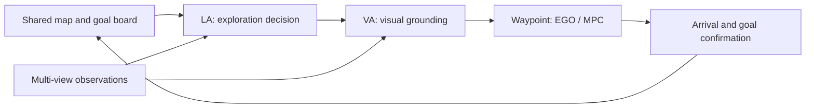

# lavira_m3

**Collaborative visual navigation with language–vision–robot agents.**

[Project Page](https://robo-lavira.github.io/hm3d-m3/) · [Paper](https://robo-lavira.github.io/hm3d-m3/static/paper.pdf) · [简体中文](README_zh.md)

lavira_m3 combines language reasoning, visual grounding, and robot navigation for
team-based object-goal search. Agents coordinate through a shared map, goal board,
and progress analysis. The method is introduced in
[HM3D-M³: A Benchmark for Multi-Agent, Multi-Modal, Multi-Object Goal Navigation](https://robo-lavira.github.io/hm3d-m3/).

This directory (`real-world-code/` in the HM3D-M3 repository) provides the ROS implementation for real robots: a shared Python decision and
mapping core, EGO/MPC navigation, FAST-LIO/EKF localization components, and a web
dashboard. Select ROS 1 or ROS 2 at the command line and describe each agent through
configuration.


*Web dashboard from the three-agent deployment: shared spatial context, target progress,
and per-agent observations in one view.*

[Overview](#overview) · [Quick Start](#quick-start) · [Run a Navigation Session](#run-a-navigation-session) · [Configuration](#configuration) · [Documentation](#documentation)

## Overview

- **Team coordination.** Share map observations, goal progress, and exploration history across agents.
- **Language-to-action workflow.** Connect LA exploration decisions and VA visual grounding to waypoint planning and motion feedback.
- **Configurable ROS integration.** Use the same application code with ROS 1 or ROS 2; configure agent IDs, footprints, camera views, and motion limits.
- **Interactive monitoring.** Inspect maps, camera panels, and decision status, and enter object targets through the browser.



## Quick Start

### 1. Install

Use a Linux environment with the development tools for your selected ROS distribution,
Eigen, PCL, and the dependencies listed in the native packages' `package.xml` files.
Local validation used Python 3.12, ROS 1 Noetic, and ROS 2 Jazzy; the offline tests also pass on Python 3.10.

From the `real-world-code/` directory (`cd real-world-code`), create an environment using the Python interpreter associated
with your ROS installation:

```bash
python3 -m venv --system-site-packages .venv
source .venv/bin/activate
python -m pip install -e '.[test]'
```

### 2. Build and load ROS

FAST-LIO (GPL-2.0) and EGO-Planner v2 (GPL-3.0) are not stored in this repository.
Fetch them at their pinned upstream commits and apply our patches once before the
first build (needs `git` and network access to GitHub; see
[native/patches/README.md](native/patches/README.md)):

```bash
bash native/fetch_native.sh
```

**ROS 2 · Jazzy**

```bash
python tools/build_native.py --ros ros2 --localization --jobs 1
source /opt/ros/jazzy/setup.bash
source .runtime/ros2/install/setup.bash
```

<details>
<summary><strong>ROS 1 · Noetic</strong></summary>

Use a separate shell for the ROS 1 environment:

```bash
source .venv/bin/activate
python tools/build_native.py --ros ros1 --localization --jobs 1
source /opt/ros/noetic/setup.bash
source .runtime/ros1/devel/setup.bash
```

Use `--ros ros1` in the following commands. Start `roscore` in its own terminal
before launching a manual ROS 1 navigation session.

</details>

`--localization` includes FAST-LIO and EKF. `--jobs` controls build parallelism;
build products are generated under `.runtime/ros1` or `.runtime/ros2`.

### 3. Check the pipeline and open the dashboard

```bash
python tools/check_ros.py --ros ros2 --pipeline
lavira_m3 hub
```

Open **<http://127.0.0.1:8770>**. The pipeline probe checks local ROS communication,
synthetic camera input, shared-map fusion, and the planning grid, then exits.
The hub serves the original field-board layout: shared map, team goals, aligned camera
views, network measurements, and recording/replay. Panels follow the configured
agent list; `map-bridge` supplies fresh camera and MPC observations.
This quick start uses local synthetic inputs.

## Run a Navigation Session

### Configure model access

LA and VA use remote model APIs. Supply the credentials through the launching
process's environment:

| Component | Default model | Endpoint | Credential variable |
| --- | --- | --- | --- |
| LA | `deepseek-flash` | `https://api.deepseek.com` | `DEEPSEEK_API_KEY` |
| VA | `qwen3.5-27b` | `https://dashscope.aliyuncs.com/compatible-mode/v1` | `DASHSCOPE_API_KEY` (or `LLM_API_KEY`) |

Set `LA_MODEL` or `VA_MODEL` to select a model. Endpoint overrides are available
through `DEEPSEEK_BASE_URL` and `VA_BASE_URL`.

### Start the components

Keep the hub running. In each additional terminal, activate the Python environment
and load the matching ROS installation and build overlay. Run one command per terminal:

| Process | ROS 2 example |
| --- | --- |
| Synthetic sensors | `lavira_m3 --ros ros2 --agent agent_0 simulate` |
| Shared-map bridge | `lavira_m3 --ros ros2 --agent agent_0 map-bridge` |
| EGO/MPC navigation | `python tools/run_navigation.py --ros ros2 --agent agent_0` |
| LA/VA decision loop | `lavira_m3 --ros ros2 --agent agent_0 agent --goals configs/goals.example.json` |

The sensor fixture produces deterministic odometry, IMU, registered point clouds,
and fixed camera images for connectivity work. For scene-based visual navigation,
replace it with your sensor publishers. Navigation uses `map` and `base_link`;
point clouds arrive registered in `map`. FAST-LIO/EKF integration uses calibrated
extrinsics, sensor timestamps, and a compatible prior map.

The default session runs in preview mode. To enable motion in a controlled environment,
add `--control` to both the navigation runner and the agent command. Freshness checks,
motion limits, and a latched emergency stop guard execution. Restart the relevant
processes to clear a latched stop.

To enter goals from the dashboard, launch the agent with the `agent` subcommand alone.
The `--goals` option loads a goal file instead.

### Repeat model tests with replay

The offline tests use fixed model responses. For a recorded request set, pass
`--replay path.json` to the `agent` subcommand. Replay matches exact request hashes
and raises an error for a missing entry. See the [fixture format](tests/fixtures/model_replay.json)
and [replay implementation](src/lavira_m3/decision/replay.py).

## Configuration

Start with [navigation.example.json](configs/navigation.example.json) and
[goals.example.json](configs/goals.example.json).

| Setting | Purpose |
| --- | --- |
| `--ros ros1` / `--ros ros2` | Select the middleware adapter |
| `--config path.json` | Load agent profiles, topics, frames, services, and limits |
| `--agent agent_0` | Select an agent from the loaded configuration |
| `agents` | Define agent IDs, body geometry, camera directions, and navigation parameters |
| `topics`, `frame`, `body_frame` | Connect sensor and navigation interfaces |
| `safety`, `services` | Set motion/freshness limits and shared HTTP endpoints |

Inspect the resolved profiles before starting a session:

```bash
lavira_m3 --config configs/navigation.example.json --ros ros2 config
```

For a team, pass the same configuration to every process and give each agent its own
ROS master or ROS 2 domain. Agents exchange maps and goal state through the shared
HTTP hub. Start all configured participants before requesting the initial joint
decision. Restart processes after editing configuration.

The hub listens on loopback by default. For remote access, use a trusted isolated
network or an authenticated reverse proxy. Keep credentials and captured runtime
images in private storage.

## Project Structure

```text
src/lavira_m3/
  decision/       LA/VA workflows, visual projection, progress and replay
  mapping/        Occupancy, shared-map fusion and planning geometry
  adapters/       ROS 1 and ROS 2 interfaces
  web/            Shared-map dashboard and target entry
native/
  common/         Shared planning/localization code and solver dependencies
  ros1/           ROS 1 build and integration files
  ros2/           ROS 2 build and integration files
  fetch_native.sh Fetches and patches FAST-LIO and EGO-Planner v2 (GPL)
  patches/        GPL patches and file manifests used by fetch_native.sh
configs/          Agent and goal examples
tools/            Native builds, ROS probes and source checks
tests/            Offline behavior and architecture regressions
assets/           Dashboard screenshot
```

All paths are relative to `real-world-code/`. Edit source files in `src/` and `native/`; the build tools assemble the runtime workspaces.
The FAST-LIO and EGO-Planner directories under `native/` are generated by
`native/fetch_native.sh` and git-ignored; after editing them, run
`bash native/fetch_native.sh --update-patches` to record the change in `native/patches/`.

## Documentation

| Resource | Contents |
| --- | --- |
| [License](../LICENSE) | License of our code and of each third-party component |
| [Native Third-Party Components](native/THIRD_PARTY.md) | Origin, license and modifications of every native component |

Run the offline regression suite with `python -m pytest -q`.

## Acknowledgments and Licensing

lavira_m3 builds on EGO-Planner, FAST-LIO, OSQP, osqp-eigen, QDLDL, the Livox ROS
Driver 2 messages, and Nav2 action definitions. Our code is released under CC BY-NC-SA 4.0
(top-level `LICENSE`). Third-party code keeps its upstream license. FAST-LIO
(GPL-2.0) and EGO-Planner (GPL-3.0) are fetched from upstream by `native/fetch_native.sh`
rather than vendored, and our patches to them in `native/patches/` are under the same
GPL licenses; see the top-level [LICENSE](../LICENSE) and
[native/THIRD_PARTY.md](native/THIRD_PARTY.md).
