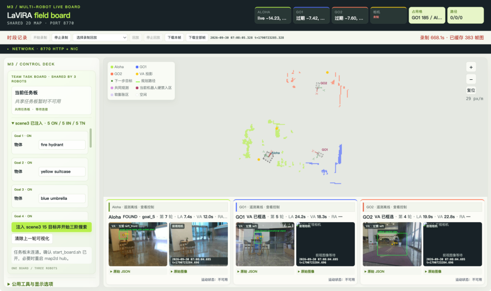
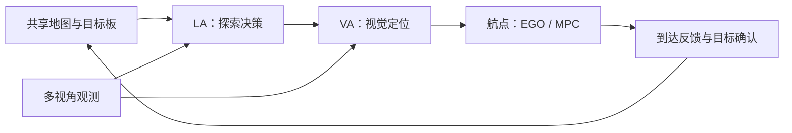

# lavira_m3

**语言—视觉—机器人智能体驱动的多目标协同导航。**

[项目主页](https://robo-lavira.github.io/hm3d-m3/) · [论文](https://robo-lavira.github.io/hm3d-m3/static/paper.pdf) · [English](README.md)

lavira_m3 将语言推理、视觉定位与机器人导航连接起来，让多个智能体通过共享地图、
目标板和进度分析协作搜索目标。方法介绍见
[HM3D-M³: A Benchmark for Multi-Agent, Multi-Modal, Multi-Object Goal Navigation](https://robo-lavira.github.io/hm3d-m3/)。

本目录（HM3D-M3 仓库中的 `real-world-code/`）提供 lavira_m3 面向真实机器人的 ROS 实现，包含共享的 Python 决策与建图核心、EGO/MPC 导航、
FAST-LIO/EKF 定位组件，以及网页控制台。通过命令行选择 ROS 1 或 ROS 2，
通过配置描述各智能体的机体尺寸、观测视角和运动参数。



*三智能体部署中的网页控制台：集中展示共享空间信息、目标进度与各智能体的实时观测。*

[系统概览](#系统概览) · [快速开始](#快速开始) · [运行导航任务](#运行导航任务) · [配置](#配置) · [文档](#文档)

## 系统概览

- **团队协作**：共享地图观测、目标进度与探索历史，形成统一的任务上下文。
- **语言到动作**：将 LA 的探索决策与 VA 的视觉定位接入航点规划、运动执行和到达反馈。
- **ROS 适配**：同一套应用代码支持 ROS 1 和 ROS 2，智能体 ID、机体尺寸、相机视角与运动限制均由配置管理。
- **网页交互**：在浏览器中查看地图、相机画面和决策状态，并输入目标物体。



## 快速开始

### 1. 安装

准备 Linux 环境、所选 ROS 发行版的开发工具、Eigen、PCL，以及原生组件
`package.xml` 声明的依赖。本地验证环境为 Python 3.12、ROS 1 Noetic 和 ROS 2 Jazzy；离线测试在 Python 3.10 上同样通过。

在 `real-world-code/` 目录下（`cd real-world-code`），使用与 ROS 安装环境匹配的 Python 解释器创建虚拟环境：

```bash
python3 -m venv --system-site-packages .venv
source .venv/bin/activate
python -m pip install -e '.[test]'
```

### 2. 构建并加载 ROS 环境

FAST-LIO（GPL-2.0）和 EGO-Planner v2（GPL-3.0）不存放在本仓库中。首次构建前运行一次下面的命令，
按固定的上游提交拉取源码并应用我们的补丁（需要 `git` 和可访问 GitHub 的网络，详见
[native/patches/README.md](native/patches/README.md)）：

```bash
bash native/fetch_native.sh
```

**ROS 2 · Jazzy**

```bash
python tools/build_native.py --ros ros2 --localization --jobs 1
source /opt/ros/jazzy/setup.bash
source .runtime/ros2/install/setup.bash
```

<details>
<summary><strong>ROS 1 · Noetic</strong></summary>

使用独立终端加载 ROS 1 环境：

```bash
source .venv/bin/activate
python tools/build_native.py --ros ros1 --localization --jobs 1
source /opt/ros/noetic/setup.bash
source .runtime/ros1/devel/setup.bash
```

后续命令使用 `--ros ros1`。手动启动 ROS 1 导航会话前，先在单独终端运行 `roscore`。

</details>

`--localization` 同时构建 FAST-LIO 和 EKF；`--jobs` 控制编译并发数。
构建产物位于 `.runtime/ros1` 或 `.runtime/ros2`。

### 3. 检查数据链路并打开控制台

```bash
python tools/check_ros.py --ros ros2 --pipeline
lavira_m3 hub
```

打开 **<http://127.0.0.1:8770>**。链路检查依次验证本地 ROS 通信、合成相机输入、
共享地图融合和规划栅格，完成后自动退出。HTTP 中心提供网页控制台，
控制台沿用原版的共享地图、任务板、并列相机、网络监控和录制回放布局。
智能体面板由配置生成，`map-bridge` 持续上传新鲜相机和 MPC 观测。
这一步使用本地合成输入。

## 运行导航任务

### 配置模型访问

LA 与 VA 通过远程 API 调用模型，密钥由进程启动环境提供：

| 组件 | 默认模型 | 服务地址 | 密钥环境变量 |
| --- | --- | --- | --- |
| LA | `deepseek-flash` | `https://api.deepseek.com` | `DEEPSEEK_API_KEY` |
| VA | `qwen3.5-27b` | `https://dashscope.aliyuncs.com/compatible-mode/v1` | `DASHSCOPE_API_KEY`（或 `LLM_API_KEY`） |

通过 `LA_MODEL`、`VA_MODEL` 选择模型，通过 `DEEPSEEK_BASE_URL`、`VA_BASE_URL`
覆盖对应服务地址。

### 启动组件

保持 HTTP 中心运行。在每个新增终端中激活 Python 环境，并加载对应 ROS 安装环境和
构建结果。以下每条命令分别在一个终端中运行：

| 进程 | ROS 2 示例 |
| --- | --- |
| 合成传感器 | `lavira_m3 --ros ros2 --agent agent_0 simulate` |
| 共享地图桥接 | `lavira_m3 --ros ros2 --agent agent_0 map-bridge` |
| EGO/MPC 导航 | `python tools/run_navigation.py --ros ros2 --agent agent_0` |
| LA/VA 决策循环 | `lavira_m3 --ros ros2 --agent agent_0 agent --goals configs/goals.example.json` |

合成传感器提供确定性的里程计、IMU、已配准点云和固定相机图像，用于连通性验证。
开展场景视觉导航时，将其替换为实际传感器发布节点。
导航采用 `map` 和 `base_link` 坐标系，输入点云需配准到 `map`。
接入 FAST-LIO/EKF 时，准备标定外参、传感器时间戳和兼容的先验地图。

默认会话采用预览模式。受控环境中启用运动时，为导航启动器和智能体命令同时添加
`--control`。执行过程由数据新鲜度检查、运动限制和锁定式急停保护；
急停触发后，通过重启相关进程解除锁定。

通过网页输入目标时，使用 `agent` 子命令启动决策循环；通过目标文件启动时，
添加 `--goals` 参数。

### 使用固定回放重复测试

离线测试使用固定模型响应。针对已记录的请求集，在 `agent` 子命令后添加
`--replay path.json`。回放按请求哈希精确匹配，缺失条目时立即报错。
格式见[回放样例](tests/fixtures/model_replay.json)和[回放实现](src/lavira_m3/decision/replay.py)。

## 配置

从 [navigation.example.json](configs/navigation.example.json) 和
[goals.example.json](configs/goals.example.json) 开始配置。

| 配置项 | 作用 |
| --- | --- |
| `--ros ros1` / `--ros ros2` | 选择 ROS 适配器 |
| `--config path.json` | 加载智能体配置、话题、坐标系、服务地址和限制参数 |
| `--agent agent_0` | 选择配置中的智能体 |
| `agents` | 定义智能体 ID、机体几何尺寸、相机方向和导航参数 |
| `topics`、`frame`、`body_frame` | 连接传感器与导航接口 |
| `safety`、`services` | 设置运动及超时限制、共享 HTTP 服务地址 |

运行前可查看解析后的智能体配置：

```bash
lavira_m3 --config configs/navigation.example.json --ros ros2 config
```

多智能体运行时，为所有进程传入同一份配置，每个智能体使用独立的 ROS master 或
ROS 2 通信域，通过共享 HTTP 中心交换地图和目标状态。
初始联合决策前启动配置中的全部参与者；修改配置后重启相应进程。

HTTP 中心默认监听回环地址。远程访问使用隔离的可信网络或带身份认证的反向代理。
密钥与运行时采集的图像保存在私有存储中。

## 项目结构

```text
src/lavira_m3/
  decision/       LA/VA 决策、视觉投影、进度分析与回放
  mapping/        占据栅格、共享地图融合与规划几何
  adapters/       ROS 1 和 ROS 2 接口
  web/            共享地图控制台与目标输入
native/
  common/         共享规划、定位源码与求解器依赖
  ros1/           ROS 1 构建与集成文件
  ros2/           ROS 2 构建与集成文件
  fetch_native.sh 拉取并修补 FAST-LIO 与 EGO-Planner v2（GPL）
  patches/        fetch_native.sh 使用的 GPL 补丁与文件清单
configs/          智能体与目标配置示例
tools/            原生构建、ROS 链路检查与源码检查
tests/            离线行为回归与架构测试
assets/           网页控制台截图
```

以上路径均相对于 `real-world-code/`。在 `src/` 和 `native/` 中维护源码，由构建工具组装运行工作区。
`native/` 下的 FAST-LIO 与 EGO-Planner 目录由 `native/fetch_native.sh` 生成且被 git 忽略；修改后运行
`bash native/fetch_native.sh --update-patches`，把改动记录到 `native/patches/`。

## 文档

| 文档 | 内容 |
| --- | --- |
| [许可证](../LICENSE) | 本项目代码及各第三方组件的许可证 |
| [原生第三方组件](native/THIRD_PARTY.md) | 每个原生组件的来源、许可证与修改 |

运行 `python -m pytest -q` 执行离线回归测试。

## 致谢与许可

lavira_m3 使用 EGO-Planner、FAST-LIO、OSQP、osqp-eigen、QDLDL、Livox ROS Driver 2
消息定义和 Nav2 action 定义等组件。本项目代码以 CC BY-NC-SA 4.0 许可证发布（见仓库顶层 `LICENSE`）；
第三方代码保留其上游许可证。FAST-LIO（GPL-2.0）和 EGO-Planner（GPL-3.0）由
`native/fetch_native.sh` 从上游拉取而非随仓库分发，`native/patches/` 中针对它们的补丁沿用相同的 GPL 许可证，详见
顶层 [LICENSE](../LICENSE) 与 [native/THIRD_PARTY.md](native/THIRD_PARTY.md)。
